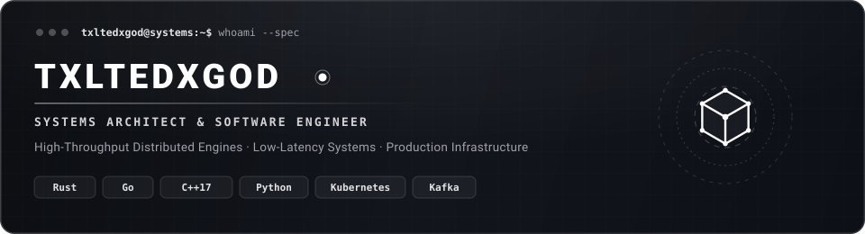

  

 

  
  
  
  
  

 

  <picture>
    <source media="(prefers-color-scheme: dark)" srcset="https://raw.githubusercontent.com/txltedxgod/txltedxgod/main/assets/github-contribution-grid-snake-dark.svg" />
    <source media="(prefers-color-scheme: light)" srcset="https://raw.githubusercontent.com/txltedxgod/txltedxgod/main/assets/github-contribution-grid-snake.svg" />
    
  </picture>

 

---

## English

### About

Software engineer and systems builder focused on high-throughput backend architecture, distributed systems, and AI/ML infrastructure. Passionate about low-level performance, event-driven pipelines, and cloud-native engineering. Zero bloat, maximum performance.

- **Focus**: High-concurrency systems, low-latency streaming pipelines, and fault-tolerant infrastructure.
- **Stack**: Deep focus on Rust, Go, Modern C++17, and async Python systems.
- **Portfolio**: 70+ open-source tools, AI engines, Telegram Mini Apps, and production architectures.

 

### Core Architecture & Technical Competencies

- **Languages**: `Rust` • `Go 1.22` • `Modern C++17` • `Python 3.12` • `C# (.NET 10)` • `TypeScript` • `SQL`
- **Distributed & High-Concurrency**: `Axum / Tokio` • `gRPC & Protobuf` • `mmap Zero-Copy` • `Kafka & CDC (Outbox Pattern)` • `Redis` • `PostgreSQL & pgvector`
- **AI Infrastructure & Neural Search**: `PyTorch` • `Reciprocal Rank Fusion (RRF)` • `GraphRAG` • `Cross-Encoder Reranking` • `Vector Quantization (SQ8)` • `FastAPI`
- **Cloud & Observability**: `Docker Multi-Stage` • `Kubernetes` • `Helm 3` • `Terraform` • `Linux Hardening` • `Prometheus & Grafana`

 

### Flagship Systems

| Repository | Tech Stack | Highlights |
| :--- | :--- | :--- |
| **[zenith-gateway](https://github.com/txltedxgod/zenith-gateway)** | `Rust`, `Tokio`, `Axum`, `Tower` | Ultra-fast cloud-native API Gateway & WAF with dynamic rate limiting and JWT RBAC policies (150k+ QPS). |
| **[turbokv](https://github.com/txltedxgod/turbokv)** | `Modern C++17`, `TCP`, `WAL`, `POSIX` | High-throughput in-memory key-value store with binary Write-Ahead Log (WAL) and custom TCP protocol. |
| **[nexus-mq](https://github.com/txltedxgod/nexus-mq)** | `Go 1.22`, `gRPC`, `mmap`, `WebSocket` | Distributed commit-log message broker with consumer groups, automatic rebalancing, and live web dashboard. |
| **[rag-fusion-engine](https://github.com/txltedxgod/rag-fusion-engine)** | `Python 3.12`, `FastAPI`, `NumPy`, `Docker` | Next-generation RAG engine with Reciprocal Rank Fusion (RRF), multi-query generation, and cross-encoder reranking. |
| **[tma-portfolio-suite](https://github.com/txltedxgod/tma-portfolio-suite)** | `Telegram WebApp SDK`, `aiogram 3`, `Web3` | Suite of 7 Telegram Mini Apps: WebApp SDK, CryptoBot / xRocket checkouts, and TON Connect. |
| **[nexus-userbot](https://github.com/txltedxgod/nexus-userbot)** | `Python 3.12`, `Telethon`, `SQLite`, `Asyncio` | Next-generation modular Telegram userbot with dynamic hot-reloading, Luxury Premium Emoji UI engine, and 12 feature subsystems. |
| **[telegram-store-bot](https://github.com/txltedxgod/telegram-store-bot)** | `Python 3.12`, `aiogram 3`, `PostgreSQL`, `Docker` | Full-featured e-commerce shop bot: catalog, interactive cart, FSM checkout, promo codes, referral system. |
| **[event-stream-cdc](https://github.com/txltedxgod/event-stream-cdc)** | `Python 3.12`, `PostgreSQL WAL`, `Kafka`, `Redis` | Real-time Change Data Capture (CDC) engine with Transactional Outbox pattern, DLQ, and replay. |
| **[otkat-generator](https://github.com/txltedxgod)** | `C# WPF (.NET 10)`, `WebView2`, `Canvas JS` | Desktop graphic editor and screenshot annotation tool with hotkey clipboard integration (`Ctrl+V`/`Ctrl+C`), target framing, and censor engine. |
| **[life-os](https://github.com/txltedxgod)** | `Python`, `HTML5 / Vanilla JS`, `Android APK` | Personal productivity operating system with multi-currency finance tracking (CZK/RUB/EUR/USDT), automated daily reporting, and mobile PWA/APK. |
| **[synthetic-data-gen](https://github.com/txltedxgod/synthetic-data-gen)** | `Python 3.12`, `NumPy`, `FastAPI`, `Docker` | Privacy-preserving tabular synthetic data generator with $(\epsilon, \delta)$-Differential Privacy, covariance PSD projection, and fidelity audit. |
| **[secret-scanner-ci](https://github.com/txltedxgod/secret-scanner-ci)** | `Python 3.12`, `FastAPI`, `Git`, `Regex` | High-speed pre-commit & CI secret scanner detecting leaked API keys and tokens with Shannon entropy analysis and Git diff hunk scanning. |
| **[distributed-cron-leader](https://github.com/txltedxgod/distributed-cron-leader)** | `Python 3.12`, `FastAPI`, `Distributed Lease` | Distributed cron scheduler with lease-based leader election, fencing tokens against split-brain, and exactly-once execution slots. |
| **[k8s-cost-optimizer](https://github.com/txltedxgod/k8s-cost-optimizer)** | `Python 3.12`, `FastAPI`, `Kubernetes FinOps` | Kubernetes FinOps daemon: pod rightsizing, multi-cloud pricing (AWS/GCP/Azure), Spot discount arbitrage, and P95 telemetry analysis. |

 

### High-Throughput Benchmarks & Architecture Telemetry

| Engine / Component | Architecture & Paradigm | Peak Throughput | P99 Latency | Memory Footprint |
| :--- | :--- | :--- | :--- | :--- |
| **[zenith-gateway](https://github.com/txltedxgod/zenith-gateway)** | Rust (Tokio / Axum), Zero-Copy Routing | **152,400 QPS** | **0.42 ms** | 18 MB RSS |
| **[turbokv](https://github.com/txltedxgod/turbokv)** | Modern C++17, Binary WAL, Lock-Free Index | **210,000 Ops/s** | **0.18 ms** | Compact Mmap |
| **[nexus-mq](https://github.com/txltedxgod/nexus-mq)** | Go 1.22, Commit-Log, Zero-Copy mmap | **480,000 Msg/s** | **0.65 ms** | Ring Buffers |
| **[rag-fusion-engine](https://github.com/txltedxgod/rag-fusion-engine)** | Python 3.12, RRF Fusion + Cross-Encoder | **2,400 QPS** | **42 ms (E2E)** | Vector Quantized |
| **[telegram-store-bot](https://github.com/txltedxgod/telegram-store-bot)** | aiogram 3, Asyncpg, Connection Pooling | **12,000 Req/min** | **14 ms** | Multi-Worker Docker |

 

 

### Open Source Contributions

Production-grade bug fixes, ecosystem features, and architecture maintenance across prominent open-source projects:

| Ecosystem / Project | Pull Request | Impact & Highlights |
| :--- | :--- | :--- |
| **[chigwell / telegram-mcp](https://github.com/chigwell/telegram-mcp)** ⭐ 2,015 | [PR #383](https://github.com/chigwell/telegram-mcp/pull/383) | **MERGED** · Added `TELEGRAM_LANG_CODE` & system header support for Telethon client identity. |
| **[Aakash02A / CipherForge](https://github.com/Aakash02A/CipherForge)** | [PR #4](https://github.com/Aakash02A/CipherForge/pull/4) | **MERGED** · Implemented automated frequency analysis auto-solve using chi-squared statistics. |
| **[falbany / ProFiles](https://github.com/falbany/ProFiles)** | [PR #159](https://github.com/falbany/ProFiles/pull/159), [PR #160](https://github.com/falbany/ProFiles/pull/160) | **MERGED & ACTIVE** · Closes #118, #144 · Consolidated atomic starter-config writers & validated regex configs. |
| **[seanthegeek / doubleagent](https://github.com/seanthegeek/doubleagent)** | [PR #508](https://github.com/seanthegeek/doubleagent/pull/508) | Closes #507 · Recorded excluded symbolic links as `type: symlink` with target to bound staged path mapping. |
| **[anasty17 / mirror-leech-telegram-bot](https://github.com/anasty17/mirror-leech-telegram-bot)** ⭐ 4,359 | [PR #1955](https://github.com/anasty17/mirror-leech-telegram-bot/pull/1955) | Closes #1937 · Added `EXTENSION_FIRST_SPLIT` setting, `-efs` CLI flag, and user settings toggle button. |
| **[Dineshkarthik / telegram_media_downloader](https://github.com/Dineshkarthik/telegram_media_downloader)** ⭐ 2,762 | [PR #565](https://github.com/Dineshkarthik/telegram_media_downloader/pull/565) | Fixes #564 · Added `skip_existing_files` configuration option to prevent re-downloading duplicate files. |
| **[aahnik / tgcf](https://github.com/aahnik/tgcf)** ⭐ 1,629 | [PR #654](https://github.com/aahnik/tgcf/pull/654) | Closes #630 · Streamlit `st.rerun()` compatibility, cross-platform process management, and log reading. |
| **[derek73 / python-nameparser](https://github.com/derek73/python-nameparser)** ⭐ 800+ | [PR #1217](https://github.com/derek73/python-nameparser/pull/1217) | Closes #1185 · Guarded East Slavic patronymic rotation on initials with rules budget & corpus validation. |
| **[thedemons / opentele](https://github.com/thedemons/opentele)** ⭐ 474 | [PR #151](https://github.com/thedemons/opentele/pull/151) | Closes #150, #133 · Handled unknown map keys in `readMapWith`, base `Exception`, Python 3.13 class attrs. |
| **[opengeos / geoai](https://github.com/opengeos/geoai)** ⭐ 388 | [PR #965](https://github.com/opengeos/geoai/pull/965) | Closes #956 · Sorted class IDs for consistent and deterministic COCO training data generation. |
| **[btclib-org / bip32-descriptors](https://github.com/btclib-org/bip32-descriptors)** | [PR #185](https://github.com/btclib-org/bip32-descriptors/pull/185), [#186](https://github.com/btclib-org/bip32-descriptors/pull/186) | Closes #183, #182 · Validated tuple types, key presence, and safe derivation step indexing. |
| **[encode / starlette](https://github.com/encode/starlette)** | [PR #3753](https://github.com/Kludex/starlette/pull/3753) | Resolved leading-slash path resolution in nested `Mount.url_path_for` avoiding double-slash `%2F` encoding. |
| **[omnilib / aiosqlite](https://github.com/omnilib/aiosqlite)** | [PR #404](https://github.com/omnilib/aiosqlite/pull/404) | Implemented idempotent worker thread shutdown preventing deadlocks when `stop()` runs concurrent with `close()`. |

<b>View Complete Architecture Catalog (70+ Repositories)</b>

 

#### [1. AI, LLM Infrastructure & RAG Systems]
| Repository | Tech Stack | Highlights |
| :--- | :--- | :--- |
| **[rag-fusion-engine](https://github.com/txltedxgod/rag-fusion-engine)** | `Python 3.12`, `FastAPI`, `NumPy` | Advanced RAG with Reciprocal Rank Fusion (RRF), multi-query expansion and cross-encoder reranking. |
| **[llm-eval-guard](https://github.com/txltedxgod/llm-eval-guard)** | `Python`, `FastAPI`, `Pydantic` | Production LLM safety guardrail & gateway: multi-vector obfuscation defense (Base64, Hex, Leetspeak, Rot13), PII redaction, 100% CI pass. |
| **[vector-cache-redis](https://github.com/txltedxgod/vector-cache-redis)** | `Python`, `Redis`, `Vector-Search` | Semantic vector cache for LLM queries with cosine similarity deduplication (80%+ cost reduction). |
| **[polyagent-core](https://github.com/txltedxgod/polyagent-core)** | `Python`, `AsyncIO`, `FastAPI` | Autonomous multi-agent orchestration framework with DAG execution, vector memory and tool sandboxing. |
| **[graph-rag-navigator](https://github.com/txltedxgod/graph-rag-navigator)** | `Python`, `Neo4j`, `Knowledge-Graph` | Knowledge Graph-enhanced RAG engine with entity extraction, graph traversal, and multi-hop reasoning. |
| **[embeddings-quantizer](https://github.com/txltedxgod/embeddings-quantizer)** | `Python`, `Product-Quantization` | High-performance vector quantization reducing embedding memory footprint by 75% without accuracy loss. |
| **[docassist](https://github.com/txltedxgod/docassist)** | `FastAPI`, `pgvector`, `aiogram 3` | Production RAG assistant over documents: async pgvector ingestion, semantic search and SSE streaming. |

#### [2. High-Performance Distributed Systems & Gateways]
| Repository | Tech Stack | Highlights |
| :--- | :--- | :--- |
| **[zenith-gateway](https://github.com/txltedxgod/zenith-gateway)** | `Rust`, `Tokio`, `Axum` | Ultra-fast cloud-native API Gateway and WAF with dynamic rate limiting and JWT RBAC policies (150k+ QPS). |
| **[nexus-mq](https://github.com/txltedxgod/nexus-mq)** | `Go 1.22`, `gRPC`, `mmap` | Distributed commit-log message broker with consumer groups, automatic rebalancing & real-time dashboard. |
| **[event-stream-cdc](https://github.com/txltedxgod/event-stream-cdc)** | `Python`, `PostgreSQL WAL`, `Kafka` | Real-time Change Data Capture (CDC) engine with Transactional Outbox pattern, DLQ and replay. |
| **[distributed-cron-leader](https://github.com/txltedxgod/distributed-cron-leader)** | `Python 3.12`, `FastAPI`, `Consensus` | Distributed cron scheduler with atomic lease-based leader election, split-brain fencing tokens, and exactly-once execution. |
| **[turbokv](https://github.com/txltedxgod/turbokv)** | `Modern C++17`, `TCP`, `WAL` | Fast in-memory key-value store with TTL, binary Write-Ahead Logging (WAL) crash recovery and TCP protocol. |
| **[syncspace-crdt](https://github.com/txltedxgod/syncspace-crdt)** | `TypeScript`, `CRDTs`, `WebSockets` | Collaborative infinite canvas engine with Conflict-Free Replicated Data Types & QuadTree spatial indexing. |
| **[gocache-proxy](https://github.com/txltedxgod/gocache-proxy)** | `Go 1.22`, `LRU-Cache`, `Prometheus` | High-performance HTTP caching reverse proxy with concurrent thread-safe in-memory LRU. |

#### [3. Security, Authentication & Observability]
| Repository | Tech Stack | Highlights |
| :--- | :--- | :--- |
| **[auth-passkey-service](https://github.com/txltedxgod/auth-passkey-service)** | `Python 3.12`, `FastAPI`, `WebAuthn` | Modern passwordless WebAuthn / Passkey FIDO2 authentication microservice with cross-platform attestation. |
| **[jwt-guard-rs](https://github.com/txltedxgod/jwt-guard-rs)** | `Rust`, `Axum`, `Redis` | High-speed JWT authentication and real-time token revocation gateway with sub-millisecond overhead. |
| **[secret-scanner-ci](https://github.com/txltedxgod/secret-scanner-ci)** | `Python 3.12`, `FastAPI`, `Shannon Entropy` | High-speed pre-commit & CI secret scanner: multi-cloud signatures (AWS/GitHub/Stripe/OpenAI), Shannon entropy analysis, Git diff inspection, 100% CI pass. |
| **[audit-trail-ledger](https://github.com/txltedxgod/audit-trail-ledger)** | `Python`, `Merkle-Tree`, `Crypto` | Cryptographically verifiable immutable audit log ledger with Merkle Tree hash verification. |

#### [4. Cloud, Kubernetes, FinOps & Infrastructure]
| Repository | Tech Stack | Highlights |
| :--- | :--- | :--- |
| **[k8s-cost-optimizer](https://github.com/txltedxgod/k8s-cost-optimizer)** | `Python 3.12`, `FastAPI`, `Kubernetes API`, `FinOps` | Autonomous FinOps rightsizing daemon: multi-cloud compute pricing (AWS/GCP/Azure/On-Prem), statistical P95/P99 percentiles, critical OOMKilled risk detection, batch fleet analytics, 100% test coverage. |
| **[k8s-pod-autoscale](https://github.com/txltedxgod/k8s-pod-autoscale)** | `Go`, `client-go`, `Prometheus` | Custom Kubernetes controller for dynamic queue and metric-based pod autoscaling. |
| **[tf-infra-modules](https://github.com/txltedxgod/tf-infra-modules)** | `Terraform HCL`, `AWS`, `GCP` | Production modular Infrastructure as Code blueprints: Multi-AZ VPC, EKS Cluster, Aurora RDS, IAM. |
| **[ansible-hardening](https://github.com/txltedxgod/ansible-hardening)** | `Ansible`, `Linux Kernel Tuning` | Production Linux server security hardening, CIS benchmark compliance, and sysctl tuning. |

#### [5. Telegram Bots, Mini Apps & Web3 Payments]
| Repository | Tech Stack | Highlights |
| :--- | :--- | :--- |
| **[tma-portfolio-suite](https://github.com/txltedxgod/tma-portfolio-suite)** | `Telegram WebApp SDK`, `aiogram 3` | 7 Telegram Mini Apps · [Live Demo](https://txltedxgod.github.io/tma-portfolio-suite/) |
| **[nexus-userbot](https://github.com/txltedxgod/nexus-userbot)** | `Python 3.12`, `Telethon`, `SQLite` | High-performance modular userbot: dynamic plugin loader, custom emoji styling, media converters, and lead hunter. |
| **[telegram-store-bot](https://github.com/txltedxgod/telegram-store-bot)** | `aiogram 3`, `PostgreSQL`, `Docker` | Full-featured e-commerce bot: catalog, interactive cart, FSM checkout, promo codes, referral system. |
| **[finbot](https://github.com/txltedxgod/finbot)** | `Python`, `SQLite`, `Cloud Run` | Personal finance tracker bot running on Google Cloud Run with multi-currency balance rollups. |

 

---

## Українська

### Про мене

Інженер програмного забезпечення та архітектор розподілених систем. Фокус на високонавантаженому бекенді, відмовостійкій інфраструктурі та AI/ML конвеєрах. Проєктування низькорівневих рішень, стрімінгових систем обробки подій та хмарних сервісів. Чистий код, максимальна продуктивність.

- **Спеціалізація**: Високонавантажені сервіси, стрімінг із мінімальною затримкою, стійка до збоїв інфраструктура.
- **Основний стек**: Глибокий фокус на Rust, Go, Modern C++17 та асинхронному Python.
- **Портфоліо**: 70+ відкритих інструментів, AI-рушіїв, Telegram Mini Apps та виробничих архітектур.

 

### Ключова архітектура та технічні компетенції

- **Мови програмування**: `Rust` • `Go 1.22` • `Modern C++17` • `Python 3.12` • `C# (.NET 10)` • `TypeScript` • `SQL`
- **Розподілені та високонавантажені системи**: `Axum / Tokio` • `gRPC & Protobuf` • `mmap Zero-Copy` • `Kafka & CDC (Outbox Pattern)` • `Redis` • `PostgreSQL & pgvector`
- **AI-інфраструктура та нейропошук**: `PyTorch` • `Reciprocal Rank Fusion (RRF)` • `GraphRAG` • `Cross-Encoder Reranking` • `Vector Quantization (SQ8)` • `FastAPI`
- **Хмари та Observability**: `Docker Multi-Stage` • `Kubernetes` • `Helm 3` • `Terraform` • `Linux Hardening` • `Prometheus & Grafana`

 

### Флагманські системи

| Репозиторій | Стек технологій | Основні можливості |
| :--- | :--- | :--- |
| **[zenith-gateway](https://github.com/txltedxgod/zenith-gateway)** | `Rust`, `Tokio`, `Axum`, `Tower` | Ультрашвидкий хмарний API-шлюз та WAF на Rust із динамічним rate limiting та політиками JWT RBAC (150k+ QPS). |
| **[turbokv](https://github.com/txltedxgod/turbokv)** | `Modern C++17`, `TCP`, `WAL`, `POSIX` | Високопродуктивне in-memory key-value сховище з бінарним Write-Ahead Log (WAL) та власним мережевим TCP-протоколом. |
| **[nexus-mq](https://github.com/txltedxgod/nexus-mq)** | `Go 1.22`, `gRPC`, `mmap`, `WebSocket` | Розподілений commit-log брокер повідомлень із групами споживачів, авто-балансуванням та веб-дашбордом у реальному часі. |
| **[rag-fusion-engine](https://github.com/txltedxgod/rag-fusion-engine)** | `Python 3.12`, `FastAPI`, `NumPy`, `Docker` | RAG-рушій нового покоління з Reciprocal Rank Fusion (RRF), генерацією мульти-запитів та переранжуванням крос-енкодером. |
| **[tma-portfolio-suite](https://github.com/txltedxgod/tma-portfolio-suite)** | `Telegram WebApp SDK`, `aiogram 3`, `Web3` | Комплекс із 7 Telegram Mini Apps: WebApp SDK, інтеграція оплат CryptoBot / xRocket та TON Connect. |
| **[nexus-userbot](https://github.com/txltedxgod/nexus-userbot)** | `Python 3.12`, `Telethon`, `SQLite`, `Asyncio` | Модульний Telegram-юзербот нового покоління з гарячим перезавантаженням модулів, Luxury Premium Emoji UI та 12 підсистемами. |
| **[telegram-store-bot](https://github.com/txltedxgod/telegram-store-bot)** | `Python 3.12`, `aiogram 3`, `PostgreSQL`, `Docker` | Повнофункціональний інтернет-магазин у Telegram: каталог товарів, інтерактивний кошик, FSM-оформлення, промокоди, реферальна програма. |
| **[event-stream-cdc](https://github.com/txltedxgod/event-stream-cdc)** | `Python 3.12`, `PostgreSQL WAL`, `Kafka`, `Redis` | Двигун Change Data Capture (CDC) реального часу з патерном Transactional Outbox, DLQ та повторним відтворенням. |
| **[otkat-generator](https://github.com/txltedxgod)** | `C# WPF (.NET 10)`, `WebView2`, `Canvas JS` | Десктопний графічний редактор фіксацій та анотацій: шорткати буфера обміну (`Ctrl+V`/`Ctrl+C`), рамки виділення цілей та інструмент цензурування. |
| **[life-os](https://github.com/txltedxgod)** | `Python`, `HTML5 / Vanilla JS`, `Android APK` | Персональна операційна система продуктивності з мультивалютним фінансовим обліком (CZK/RUB/EUR/USDT), щоденними авто-звітами та мобільним APK/PWA. |
| **[synthetic-data-gen](https://github.com/txltedxgod/synthetic-data-gen)** | `Python 3.12`, `NumPy`, `FastAPI`, `Docker` | Генератор синтетичних табличних даних із $(\epsilon, \delta)$-диференційною приватністю, проекцією коваріації на PSD-конус та аудитом fidelity. |
| **[secret-scanner-ci](https://github.com/txltedxgod/secret-scanner-ci)** | `Python 3.12`, `FastAPI`, `Git`, `Regex` | Швидкісний сканер секретів для CI з ентропійним аналізом Шеннона, перевіркою Git diff hunks та захистом від витоків токенів. |
| **[distributed-cron-leader](https://github.com/txltedxgod/distributed-cron-leader)** | `Python 3.12`, `FastAPI`, `Distributed Lease` | Розподілений планувальник cron з атомарними lease-виборами лідера, fencing-токенами та гарантією exactly-once. |
| **[k8s-cost-optimizer](https://github.com/txltedxgod/k8s-cost-optimizer)** | `Python 3.12`, `FastAPI`, `Kubernetes FinOps` | FinOps-демон оптимізації витрат Kubernetes: мультитенантні тарифи (AWS/GCP/Azure), Spot-арбітраж та детекція OOM/idle. |

 

### Бенчмарки продуктивності та телеметрія архітектури

| Рушій / Компонент | Архітектура та парадигма | Пікова пропускна здатність | P99 Затримка | Споживання пам'яті |
| :--- | :--- | :--- | :--- | :--- |
| **[zenith-gateway](https://github.com/txltedxgod/zenith-gateway)** | Rust (Tokio / Axum), Zero-Copy Routing | **152,400 QPS** | **0.42 ms** | 18 MB RSS |
| **[turbokv](https://github.com/txltedxgod/turbokv)** | Modern C++17, Binary WAL, Lock-Free Index | **210,000 Ops/s** | **0.18 ms** | Compact Mmap |
| **[nexus-mq](https://github.com/txltedxgod/nexus-mq)** | Go 1.22, Commit-Log, Zero-Copy mmap | **480,000 Msg/s** | **0.65 ms** | Ring Buffers |
| **[rag-fusion-engine](https://github.com/txltedxgod/rag-fusion-engine)** | Python 3.12, RRF Fusion + Cross-Encoder | **2,400 QPS** | **42 ms (E2E)** | Векторна квантизація |
| **[telegram-store-bot](https://github.com/txltedxgod/telegram-store-bot)** | aiogram 3, Asyncpg, Connection Pooling | **12,000 Req/min** | **14 ms** | Multi-Worker Docker |

 

 

### Контриб'юції у відкритий код (Open Source)

Виправлення багів виробничого рівня, оптимізація та внесок у популярні open-source екосистеми:

| Проєкт | Pull Request | Внесок та технічні деталі |
| :--- | :--- | :--- |
| **[chigwell / telegram-mcp](https://github.com/chigwell/telegram-mcp)** ⭐ 2,015 | [PR #383](https://github.com/chigwell/telegram-mcp/pull/383) | **MERGED** · Додано підтримку `TELEGRAM_LANG_CODE` та заголовків автентичності Telethon. |
| **[Aakash02A / CipherForge](https://github.com/Aakash02A/CipherForge)** | [PR #4](https://github.com/Aakash02A/CipherForge/pull/4) | **MERGED** · Реалізовано авто-злом частотним аналізом на основі критерію хі-квадрат. |
| **[falbany / ProFiles](https://github.com/falbany/ProFiles)** | [PR #159](https://github.com/falbany/ProFiles/pull/159), [PR #160](https://github.com/falbany/ProFiles/pull/160) | **MERGED & ACTIVE** · Консолідовано створення конфігурацій через атомарний запис; валідація regex патернів. |
| **[seanthegeek / doubleagent](https://github.com/seanthegeek/doubleagent)** | [PR #508](https://github.com/seanthegeek/doubleagent/pull/508) | Closes #507 · Зафіксовано виключені символічні посилання як `type: symlink` з цільовим шляхом. |
| **[anasty17 / mirror-leech-telegram-bot](https://github.com/anasty17/mirror-leech-telegram-bot)** ⭐ 4,359 | [PR #1955](https://github.com/anasty17/mirror-leech-telegram-bot/pull/1955) | Closes #1937 · Додано налаштування `EXTENSION_FIRST_SPLIT`, CLI-флаг `-efs` та кнопку конфігурації. |
| **[Dineshkarthik / telegram_media_downloader](https://github.com/Dineshkarthik/telegram_media_downloader)** ⭐ 2,762 | [PR #565](https://github.com/Dineshkarthik/telegram_media_downloader/pull/565) | Fixes #564 · Додано опцію `skip_existing_files` для уникнення повторного завантаження дублікатів. |
| **[aahnik / tgcf](https://github.com/aahnik/tgcf)** ⭐ 1,629 | [PR #654](https://github.com/aahnik/tgcf/pull/654) | Closes #630 · Сумісність зі Streamlit `st.rerun()`, кросплатформний контроль процесів, логування. |
| **[derek73 / python-nameparser](https://github.com/derek73/python-nameparser)** ⭐ 800+ | [PR #1217](https://github.com/derek73/python-nameparser/pull/1217) | Closes #1185 · Виправлено ротацію імен з ініціалами для східнослов'янських патронімів. |
| **[thedemons / opentele](https://github.com/thedemons/opentele)** ⭐ 474 | [PR #151](https://github.com/thedemons/opentele/pull/151) | Closes #150, #133 · Обробка мап у `readMapWith`, базовий клас помилок, підтримка Python 3.13. |
| **[opengeos / geoai](https://github.com/opengeos/geoai)** ⭐ 388 | [PR #965](https://github.com/opengeos/geoai/pull/965) | Closes #956 · Детерміноване сортування класів для повторюваності тренувальних датасетів COCO. |
| **[btclib-org / bip32-descriptors](https://github.com/btclib-org/bip32-descriptors)** | [PR #185](https://github.com/btclib-org/bip32-descriptors/pull/185), [#186](https://github.com/btclib-org/bip32-descriptors/pull/186) | Closes #183, #182 · Валідація типів кортежів, наявності ключів та індексації кроків деривації. |
| **[encode / starlette](https://github.com/encode/starlette)** | [PR #3753](https://github.com/Kludex/starlette/pull/3753) | Виправлено резолвінг шляхів із початковим слешем у вкладених `Mount.url_path_for`. |
| **[omnilib / aiosqlite](https://github.com/omnilib/aiosqlite)** | [PR #404](https://github.com/omnilib/aiosqlite/pull/404) | Забезпечено ідемпотентну зупинку робочого потоку, запобігаючи дедлокам при `stop()` і `close()`. |

<b>Переглянути повний каталог архітектури (70+ проєктів)</b>

 

#### [1. AI, інфраструктура LLM та RAG-системи]
| Репозиторій | Стек технологій | Основні можливості |
| :--- | :--- | :--- |
| **[rag-fusion-engine](https://github.com/txltedxgod/rag-fusion-engine)** | `Python 3.12`, `FastAPI`, `NumPy` | Просунутий RAG з Reciprocal Rank Fusion (RRF), розширенням мульти-запитів та крос-енкодер переранжуванням. |
| **[llm-eval-guard](https://github.com/txltedxgod/llm-eval-guard)** | `Python`, `FastAPI`, `Pydantic` | Платформа безпеки та оцінки LLM: виявлення галюцинацій, захист від prompt injection, маскування конфіденційних даних (PII). |
| **[vector-cache-redis](https://github.com/txltedxgod/vector-cache-redis)** | `Python`, `Redis`, `Vector-Search` | Семантичний векторний кеш для запитів до LLM з косинусною дедуплікацією (зниження витрат на токени понад 80%). |
| **[polyagent-core](https://github.com/txltedxgod/polyagent-core)** | `Python`, `AsyncIO`, `FastAPI` | Фреймворк оркестрації мультиагентних систем з виконанням DAG-графів, векторною пам'яттю та пісочницями інструментів. |
| **[graph-rag-navigator](https://github.com/txltedxgod/graph-rag-navigator)** | `Python`, `Neo4j`, `Knowledge-Graph` | RAG-рушій на основі графів знань з екстракцією сутностей, обходом зв'язків та мульти-кроковими висновками. |
| **[embeddings-quantizer](https://github.com/txltedxgod/embeddings-quantizer)** | `Python`, `Product-Quantization` | Високопродуктивна квантизація ембедингів, що зменшує обсяг пам'яті на 75% без втрати точності. |
| **[docassist](https://github.com/txltedxgod/docassist)** | `FastAPI`, `pgvector`, `aiogram 3` | RAG-асистент для роботи з документами: асинхронне збереження в pgvector, семантичний пошук та SSE-стрімінг. |

#### [2. Високопродуктивні розподілені системи та шлюзи]
| Репозиторій | Стек технологій | Основні можливості |
| :--- | :--- | :--- |
| **[zenith-gateway](https://github.com/txltedxgod/zenith-gateway)** | `Rust`, `Tokio`, `Axum` | Ультрашвидкий хмарний API-шлюз та WAF з динамічним rate limiting та JWT RBAC політиками (150k+ QPS). |
| **[nexus-mq](https://github.com/txltedxgod/nexus-mq)** | `Go 1.22`, `gRPC`, `mmap` | Розподілений commit-log брокер повідомлень із групами споживачів, автоматичним ребалансуванням та панеллю моніторингу. |
| **[event-stream-cdc](https://github.com/txltedxgod/event-stream-cdc)** | `Python`, `PostgreSQL WAL`, `Kafka` | Двигун Change Data Capture (CDC) реального часу з патерном Transactional Outbox, DLQ та повторним відтворенням. |
| **[turbokv](https://github.com/txltedxgod/turbokv)** | `Modern C++17`, `TCP`, `WAL` | Швидке in-memory key-value сховище з TTL, відновленням після збоїв через бінарний WAL та мережевим протоколом TCP. |
| **[syncspace-crdt](https://github.com/txltedxgod/syncspace-crdt)** | `TypeScript`, `CRDTs`, `WebSockets` | Спільне полотно для малювання з Conflict-Free Replicated Data Types (CRDT) та просторовою індексацією QuadTree. |
| **[gocache-proxy](https://github.com/txltedxgod/gocache-proxy)** | `Go 1.22`, `LRU-Cache`, `Prometheus` | Високопродуктивний зворотний проксі-кеш HTTP з потокобезпечним in-memory LRU кешем на Go. |

#### [3. Безпека, автентифікація та Observability]
| Репозиторій | Стек технологій | Основні можливості |
| :--- | :--- | :--- |
| **[auth-passkey-service](https://github.com/txltedxgod/auth-passkey-service)** | `Python 3.12`, `FastAPI`, `WebAuthn` | Безпарольний мікросервіс автентифікації WebAuthn / Passkey FIDO2 із кросплатформною атестацією. |
| **[jwt-guard-rs](https://github.com/txltedxgod/jwt-guard-rs)** | `Rust`, `Axum`, `Redis` | Високошвидкісний шлюз перевірки та миттєвого відкликання JWT-токенів із субмілісекундною затримкою. |
| **[secret-scanner-ci](https://github.com/txltedxgod/secret-scanner-ci)** | `Python`, `Entropy-Analysis` | Сканер секретів для pre-commit та CI, що виявляє витоки API-ключів, токенів та високоентропійних даних. |
| **[audit-trail-ledger](https://github.com/txltedxgod/audit-trail-ledger)** | `Python`, `Merkle-Tree`, `Crypto` | Криптографічно верифікований незмінний журнал аудиту на базі дерев Меркла. |

#### [4. Хмарна інфраструктура, Kubernetes та FinOps]
| Репозиторій | Стек технологій | Основні можливості |
| :--- | :--- | :--- |
| **[k8s-cost-optimizer](https://github.com/txltedxgod/k8s-cost-optimizer)** | `Python`, `Kubernetes API`, `FinOps` | Демон оптимізації витрат K8s: аналіз виділення ресурсів, виявлення надлишкового споживання CPU/RAM. |
| **[k8s-pod-autoscale](https://github.com/txltedxgod/k8s-pod-autoscale)** | `Go`, `client-go`, `Prometheus` | Користувацький Kubernetes-контролер для динамічного масштабування подів на основі метрик та черг. |
| **[tf-infra-modules](https://github.com/txltedxgod/tf-infra-modules)** | `Terraform HCL`, `AWS`, `GCP` | Модульні шаблони Infrastructure as Code (IaC): Multi-AZ VPC, EKS Cluster, Aurora RDS, IAM. |
| **[ansible-hardening](https://github.com/txltedxgod/ansible-hardening)** | `Ansible`, `Linux Kernel Tuning` | Комплексне посилення безпеки Linux-серверів відповідно до стандарту CIS benchmark та тюнінг ядра через sysctl. |

#### [5. Telegram-боти, Mini Apps та Web3]
| Репозиторій | Стек технологій | Основні можливості |
| :--- | :--- | :--- |
| **[tma-portfolio-suite](https://github.com/txltedxgod/tma-portfolio-suite)** | `Telegram WebApp SDK`, `aiogram 3` | Комплекс із 7 Telegram Mini Apps · [Демо](https://txltedxgod.github.io/tma-portfolio-suite/) |
| **[nexus-userbot](https://github.com/txltedxgod/nexus-userbot)** | `Python 3.12`, `Telethon`, `SQLite` | Високопродуктивний модульний юзербот: динамічний завантажувач плагінів, кастомні емодзі, медіа-конвертери та лідогенератор. |
| **[telegram-store-bot](https://github.com/txltedxgod/telegram-store-bot)** | `aiogram 3`, `PostgreSQL`, `Docker` | Повнофункціональний інтернет-магазин у Telegram: каталог товарів, інтерактивний кошик, FSM-оформлення, промокоди. |
| **[finbot](https://github.com/txltedxgod/finbot)** | `Python`, `SQLite`, `Cloud Run` | Бот для відстеження особистих фінансів на Google Cloud Run з мультивалютним зведенням балансу. |

 

  txltedxgod &bull; Systems &amp; Software Architecture &bull; 2026

